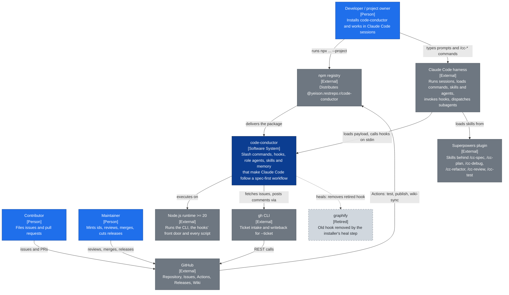
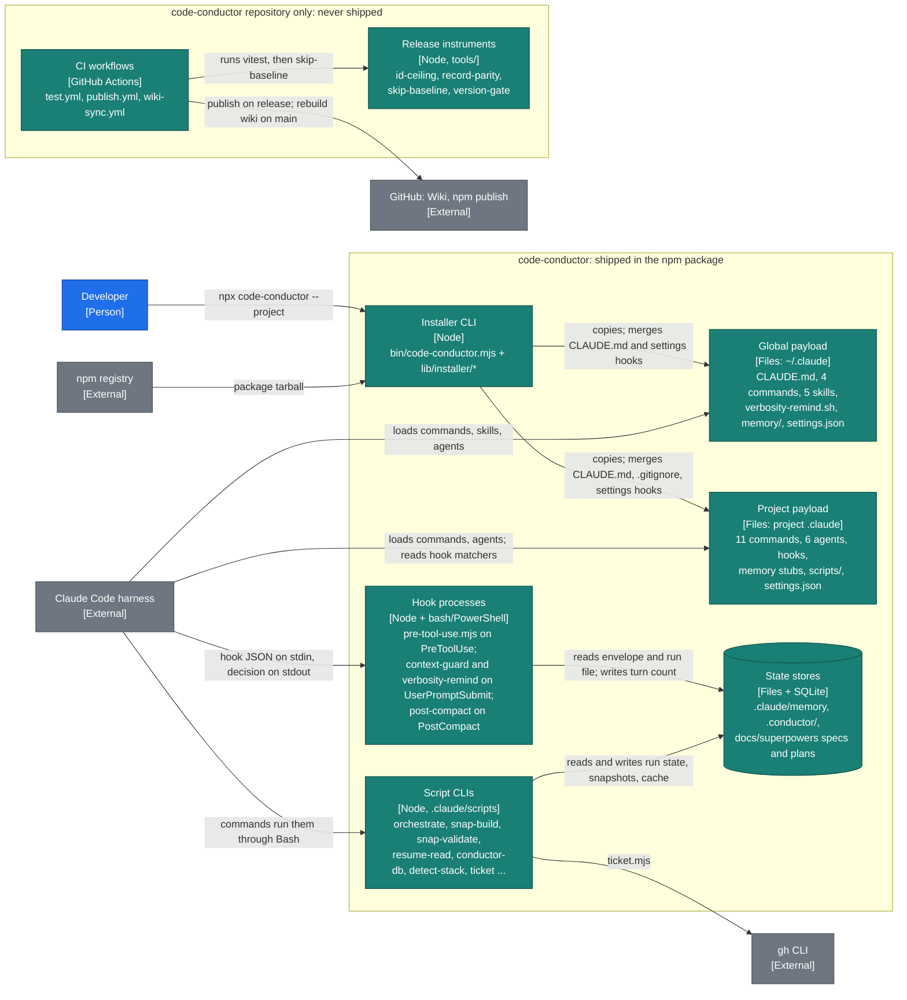

# Architecture Overview

This page describes code-conductor with the [C4 model](https://c4model.com/): **Level 1** puts the system among the people and systems around it, **Level 2** opens it into the containers that actually run or hold state. [C4 Components](C4-Components) goes one level deeper (Level 3) into the guard chain, the orchestrator, the installer and the context guard, and ends with one Level 4 sequence.

Each element names the reference page that documents it in detail.

Legend for every diagram on these pages: blue is a person, dark blue is code-conductor, teal is a container of code-conductor, grey is an external system, and dashed grey is retired.

## Level 1: System Context



| Element | Role | Read more |
|---|---|---|
| Developer / project owner | Installs with `npx`, then works through `/cc-*` commands | [Getting Started](Getting-Started), [Commands Reference](Commands-Reference) |
| Contributor | Files an issue; work starts only when the maintainer mints an id | [Contributing](Contributing) |
| Maintainer | Mints ids, approves specs and plans, merges, publishes releases | [Contributing](Contributing) |
| Claude Code harness | The host: every command, skill, agent and hook runs inside it | [FAQ](FAQ) |
| Node.js `>= 20` | The installer refuses older Node; the SQLite cache needs `>= 22.5` and self-disables below it | [Memory Architecture](Memory-Architecture) |
| npm registry | `publish.yml` publishes on a GitHub Release, with provenance | [Contributing](Contributing) |
| GitHub | Source, Issues, Actions CI, Releases, and this wiki (rebuilt by `wiki-sync.yml`) | [Contributing](Contributing) |
| `gh` CLI | Only `/cc-orchestrate --ticket` and `ticket.mjs writeback`; code-conductor holds no credential | [Orchestrator Guide](Orchestrator-Guide) |
| Superpowers plugin | Not installed by code-conductor; six commands call its skills | [Getting Started](Getting-Started) |
| graphify | Retired. The installer removes its old `UserPromptSubmit` hook, with a backup, and deletes its hook files only when they match the shipped bytes | [FAQ](FAQ) |

## Level 2: Containers



| Container | What it is | Read more |
|---|---|---|
| **Installer CLI** | `bin/code-conductor.mjs` with `lib/installer/*`, published as the package's npm `bin`. There is no `install.sh` or `install.ps1`. Flags: `--project`, `--verbosity MIN\|INFO\|VERBOSE`, `--version`, `--help` | [Getting Started](Getting-Started), [C4 Components: installer](C4-Components#installer-phases) |
| **Global payload** `~/.claude/` | `CLAUDE.md` (managed block merged), `/cc-checkpoint`, `/cc-stack`, `/cc-lang`, `/cc-compact`, the five skills under `skills/<name>/SKILL.md`, `hooks/verbosity-remind.sh`, `memory/personal.md` and `verbosity.md`, `settings.json` | [Skills](Skills), [Memory Architecture](Memory-Architecture) |
| **Project payload** `<project>/.claude/` | 11 project commands, 6 agents (`spec`, `plan`, `code`, `audit`, `qa`, `define-review`), the hooks, memory stubs, `review-loop.settings.json`, `settings.json`, and all 11 `scripts/*.mjs` under `.claude/scripts/` | [Commands Reference](Commands-Reference), [Band Roles & Agents](Band-Roles-and-Agents) |
| **Hook processes** | Short-lived processes Claude Code starts per event. `pre-tool-use.mjs` (Guards 1–7) runs on `Read`, `Write`, `Edit`, `create_file`, `write_file`, `Bash`, `Agent` and `SendMessage`. `context-guard` (`.sh` and `.ps1`) and `verbosity-remind.sh` run on every `UserPromptSubmit`; `post-compact` (`.sh` and `.ps1`) runs after `/compact` | [Guards Reference](Guards-Reference), [C4 Components](C4-Components) |
| **Script CLIs** | Zero-dependency Node modules the commands call: `orchestrate.mjs` (band router), `snap-build`/`snap-validate`/`snap-contract` (SNAP), `resume-read`, `conductor-db` (SQLite cache), `session-id`, `detect-stack`, `claude-md-fields`, `init-wizard`, `ticket` | [SNAP Protocol](SNAP-Protocol), [Orchestrator Guide](Orchestrator-Guide) |
| **State stores** | `.claude/memory/` (`project.md` in git; `turn-count.txt`, `band-envelope.json`, `orchestrator-run.json`, `session-snapshot.json`), `.conductor/` (local-only: `cache.db`, `ticket/`), and `docs/superpowers/specs` and `plans` written by `/cc-spec` and `/cc-plan` | [Memory Architecture](Memory-Architecture) |
| **Release instruments** `tools/` | Repository-only. `id-ceiling` is run by hand before minting; `version-gate` and `record-parity` run through `tests/tools/repo-invariants.test.js`; `skip-baseline` runs in `test.yml` after the suite | [Contributing](Contributing) |
| **CI workflows** | `test.yml` (Node 20 and 24 on Ubuntu, Node 24 on Windows), `publish.yml` (on a published GitHub Release), `wiki-sync.yml` (on push to `main`, fail-open) | [Contributing](Contributing) |

## What runs when you type a prompt

1. Claude Code fires `UserPromptSubmit`: `verbosity-remind.sh` re-injects the active verbosity level, and `context-guard` counts the turn for this session and warns at 80% of the threshold.
2. The model answers by calling tools. Before each `Read`, `Write`, `Edit`, `create_file`, `write_file`, `Bash`, `Agent` or `SendMessage`, Claude Code starts `pre-tool-use.mjs`, which runs that tool's guards in order and returns allow, ask or deny. See [C4 Components: guard chain](C4-Components#pre-tool-use-guard-chain).
3. A `/cc-*` command is a prompt file; the ones that keep state call the script CLIs (`resume-read`, `conductor-db`, `orchestrate`, `snap-validate`) through `Bash`.
4. After `/compact`, `post-compact` resets the turn counter and reminds you of the last checkpoint.

The manual workflow is `/cc-spec` → approval → `/cc-plan` → approval → `/cc-implement`, with `/cc-checkpoint` and `/cc-compact` at phase boundaries. `/cc-orchestrate` runs the same route through role agents: see [C4 Components: orchestrator](C4-Components#cc-orchestrate-bands) and the [Orchestrator Guide](Orchestrator-Guide).

## File layout in a host project

```
<project>/
├── .claude/
│   ├── agents/          # spec, plan, code, audit, qa, define-review
│   ├── commands/        # 11 /cc-* project commands
│   ├── hooks/           # pre-tool-use.mjs (Guards 1–7), context-guard (.sh/.ps1),
│   │                    # post-compact (.sh/.ps1), verbosity-remind.sh
│   ├── memory/          # project.md, bash-scan-allowlist.txt, context-threshold.txt,
│   │                    # plus run state written at runtime
│   ├── scripts/         # the 11 script CLIs
│   ├── settings.json    # hook matchers
│   └── review-loop.settings.json  # auto-mode exception for the review loop
├── .conductor/          # local-only (gitignored): cache.db, ticket/
├── .gitignore           # gains one labelled Code Conductor block
└── CLAUDE.md            # managed block between cc:managed markers + your content
```
