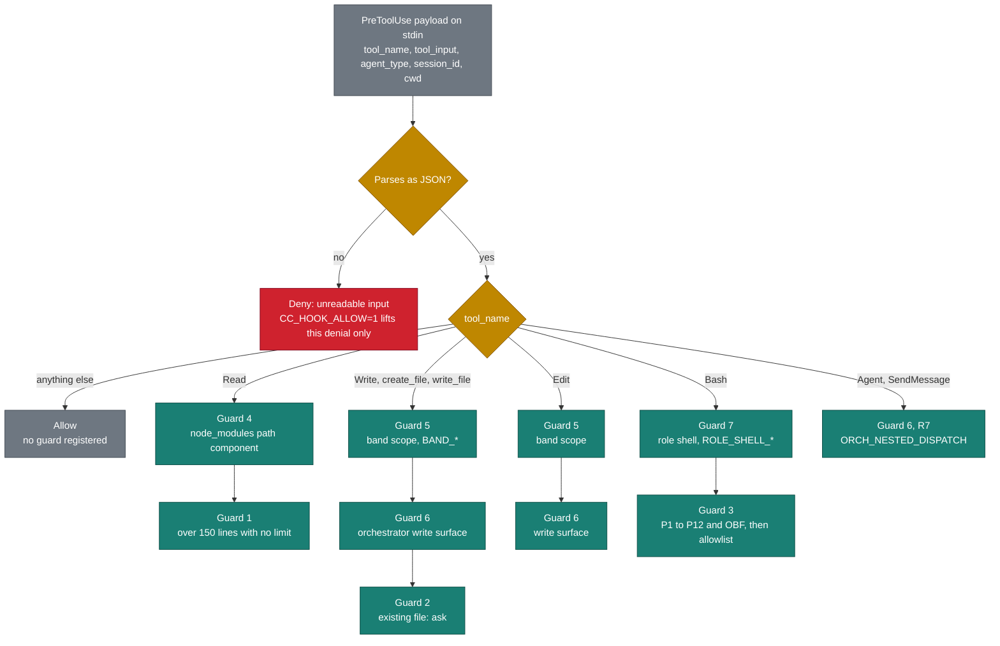
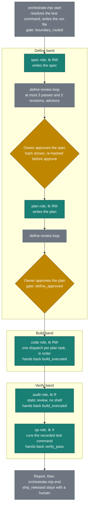
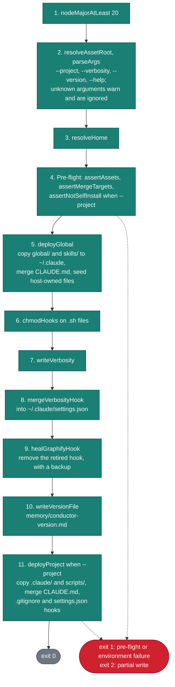
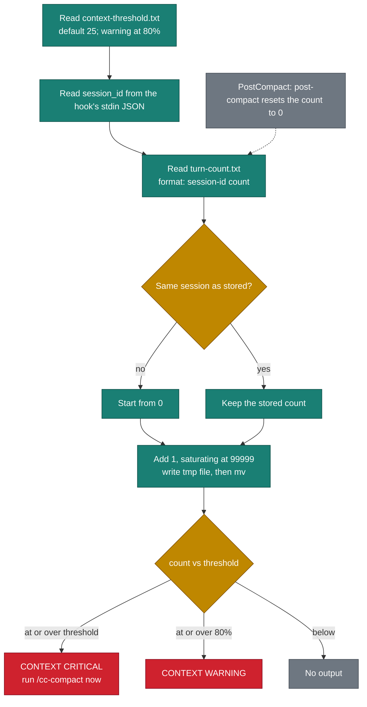
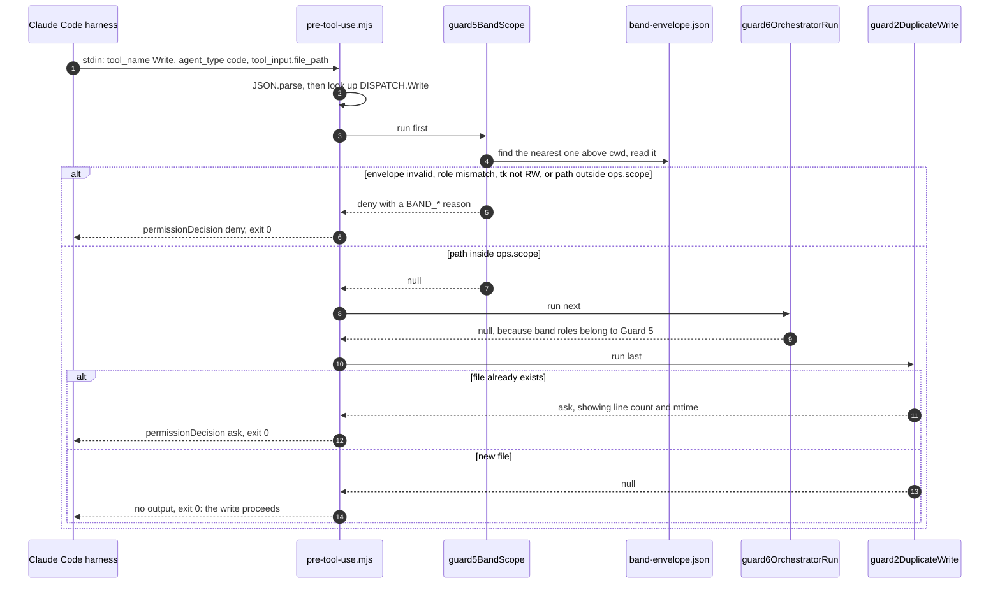

# C4 Components

Level 3 of the [C4 model](https://c4model.com/): the components inside the containers on [Architecture Overview](Architecture-Overview). Level 4 appears once, at the end, where a sequence shows something a component diagram cannot.

Colors follow the legend on [Architecture Overview](Architecture-Overview); amber marks a decision, red a deny.

## Pre-tool-use guard chain

**Container:** hook processes. **Source:** `.claude/hooks/pre-tool-use.mjs`, one zero-dependency Node script. Claude Code starts it before every tool named in the `PreToolUse` matcher of `.claude/settings.json`: `Read|Write|Edit|create_file|write_file|Bash|Agent|SendMessage`.

The script looks up the payload's `tool_name` in its `DISPATCH` table and runs that tool's guards **in order**. The first guard that returns a decision wins, and the rest do not run. Every path exits 0: a denial is data in `hookSpecificOutput.permissionDecision`, never a crash.

Why this order:

- **Guard 4 before Guard 1.** A `node_modules` read is denied whatever its size.
- **Guards 5 and 6 before Guard 2.** A scope denial must outrank Guard 2's "ask", and Guard 6 steps aside for the band roles Guard 5 governs.
- **Guard 7 before Guard 3.** Under `CC_GUARD3_WARN=1`, Guard 3 asks instead of denying, and an ask must never outrank a role's shell denial.
- **`Edit` has no Guard 2.** Editing in place is what Guard 2 recommends.

The detail for each guard, its reason codes and its limits is on [Guards Reference](Guards-Reference).

## `/cc-orchestrate` bands

**Containers:** project payload (the `/cc-orchestrate` command and six agent files), script CLIs (`orchestrate.mjs`, `snap-build.mjs`, `snap-validate.mjs`, `ticket.mjs`) and state stores (`.claude/memory/orchestrator-run.json`, `band-envelope.json`, `.conductor/`).

The main session is the orchestrator. It is the only thing that dispatches agents during a run, and Guard 6 (R7) denies a subagent's `Agent` or `SendMessage`.

Each role dispatch is the same SNAP v3 handoff:

```mermaid
flowchart LR
  inst["orchestrate.mjs install ROLE"]
  build["snap-build<br/>SNAP v3 envelope: sys.role, sys.tk,<br/>ops.scope, ops.gate"]
  val["snap-validate --to ROLE<br/>ops.gate must be the previous band's exit"]
  env[("band-envelope.json")]
  disp["Agent tool<br/>agent_type = ROLE"]
  work["Role works<br/>Guard 5 bounds writes to ops.scope,<br/>Guard 7 bounds Bash"]
  hb["exactly one SNAP_HANDBACK line"]
  rec["orchestrate.mjs handback<br/>checks the role and its allowed gate"]

  inst --> build --> val --> env --> disp --> work --> hb --> rec

  classDef step fill:#1a7f74,stroke:#0d4d46,color:#ffffff
  class inst,build,val,env,disp,work,hb,rec step
```

| Role | Band | `tk` | Tools | Gate it hands back |
|---|---|---|---|---|
| `spec` | define | RW | Read, Grep, Glob, Write, Edit | `boundary_routed` |
| `plan` | define | RW | Read, Grep, Glob, Write, Edit | `boundary_routed` |
| `code` | build | RW | Read, Grep, Glob, Write, Edit, Bash | `build_executed` |
| `audit` | verify | R | Read, Grep, Glob | `build_executed` |
| `qa` | verify | X | Read, Grep, Glob, Bash | `verify_pass` |
| `define-review` | none (reviewer) | none | Read, Grep, Glob | none: reports open checklist rows |

Approvals are `orchestrate.mjs approve spec` and `approve plan`, recorded in the run file as `{at, by}`. Only `approve plan` moves the gate to `define_approved`. `--auto` skips the pause between dispatches, never an approval. The verbs are `start`, `install`, `handback`, `approve`, `review` and `end`. A refusal exits 2 and writes nothing; a halt exits 1 and is recorded in the run file. A halted run cannot resume: end it, then start again.

More: [Orchestrator Guide](Orchestrator-Guide), [Band Roles & Agents](Band-Roles-and-Agents), [SNAP Protocol](SNAP-Protocol).

## Installer phases

**Container:** installer CLI. **Source:** `bin/code-conductor.mjs` drives `lib/installer/` (`env`, `config`, `deploy`, `file-merge`, `merge-md`, `settings`, `settings-merge`, `host-owned`, `heal`).

How each merge treats your files:

- **`CLAUDE.md`.** Only the text between `<!-- cc:managed:start -->` and `<!-- cc:managed:end -->` is replaced. A file without the markers gets the block appended at the end. Damaged markers, or a file that ends inside an unclosed code fence, leave the file untouched with a warning.
- **`.gitignore`.** Gains one labelled block.
- **`settings.json`.** Only its `hooks` entries are merged, matched by fingerprint. `permissions` is written only on a fresh install.
- **Backups.** Every change to one of these files is backed up first as `<file>.installer-backup.<UTC>`, the five newest are kept, and each backup is reported on stdout.

## Context guard

**Container:** hook processes. **Source:** `.claude/hooks/context-guard.sh` and `.ps1`, on every `UserPromptSubmit`; `post-compact.sh` and `.ps1` reset it.

A count left by another session says nothing about this session's context, so a new `session_id` starts from zero (`[BUG-056]`). The hook always exits 0, because a non-zero `UserPromptSubmit` hook would block the prompt.

## Level 4: one guard dispatch

A `Write` from the `code` role during a live `/cc-orchestrate` run. This is the call that the band envelope exists to bound.

